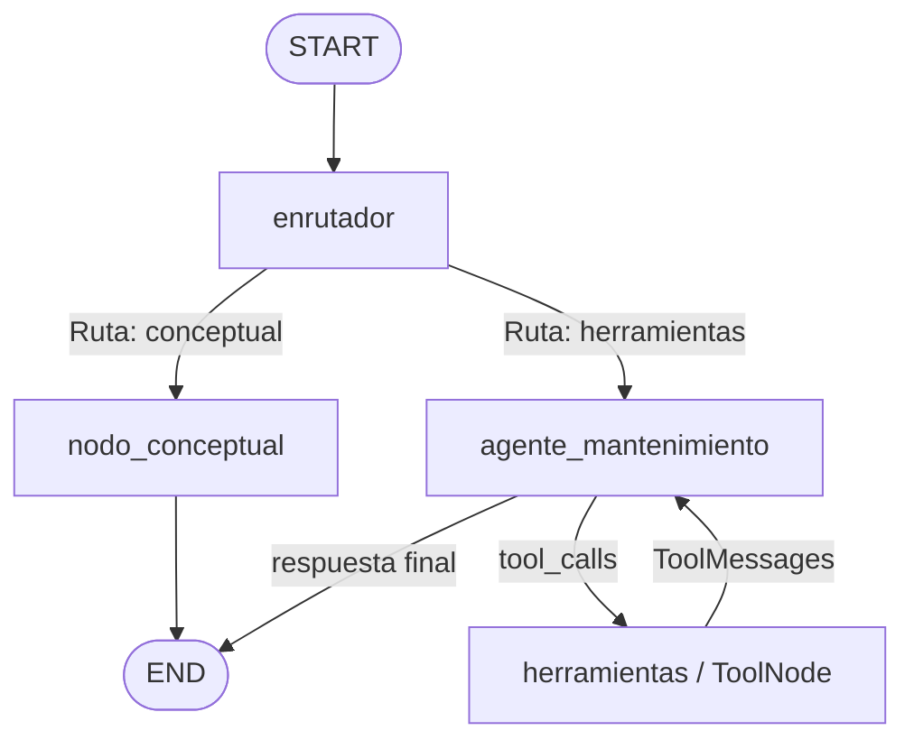

# MantenIA v3

Sistema agéntico inteligente para la gestión y planificación del mantenimiento de motocicletas, evolucionado a **LangGraph**: un grafo de estados cíclico con nodos especializados, `ToolNode` y memoria con checkpointer.

MantenIA ayuda a los propietarios de motocicletas a llevar un control de los mantenimientos realizados y a identificar cuáles mantenimientos pueden ser necesarios según el kilometraje, el historial y las recomendaciones técnicas disponibles.

## Problema que resuelve

Los propietarios de motocicletas pueden olvidar cuándo realizaron el último mantenimiento o desconocer qué revisiones necesita su moto según el kilometraje y el tiempo transcurrido. Esto puede ocasionar retrasos en el mantenimiento y una falta de control sobre el historial de la motocicleta.

## Evolución v02 ➔ v03

| Limitación en v02 | Solución en v03 |
|---|---|
| Agente como caja negra (`create_agent()`) | Grafo explícito con 4 nodos que se pueden inspeccionar |
| Memoria como texto concatenado en el prompt | `MemorySaver` + `thread_id` (checkpoints nativos) |
| Flujo sin ciclos explícitos | Arista cíclica `herramientas ➔ agente_mantenimiento` (ReAct) |
| Router Chain + Agent en `core/agent.py` | Nodo enrutador + bifurcación condicional en `graph/workflow.py` |

## Arquitectura

El flujo deja de ser una tubería rígida y se convierte en un **grafo de estados con bucles de retroalimentación**:

1. **`enrutador`**: clasifica la intención con salida estructurada (Pydantic, temperatura 0) en `conceptual` o `herramientas`.
2. **`nodo_conceptual`**: responde teoría general sin invocar herramientas y termina. Ahorra tiempo y tokens.
3. **`agente_mantenimiento`**: el modelo con las 7 herramientas vinculadas. Decide si invoca tools o responde.
4. **`herramientas`**: `ToolNode` que ejecuta las tools solicitadas y devuelve los `ToolMessage` al agente (ciclo).



La barra lateral de la app muestra el mismo diagrama, exportado de forma nativa por el grafo compilado.

### Capas y responsabilidades

| Módulo | Responsabilidad exclusiva | Antipatrón a evitar |
|---|---|---|
| `app.py` | Interfaz de chat en Streamlit, entrada del usuario y trazabilidad visual | No poner lógica del grafo |
| `core/session.py` | Estado de la interfaz, sesiones de usuario, `thread_id` y ejecución de cada turno del grafo | No duplicar lógica de herramientas ni guardar memoria como texto |
| `graph/state.py` | Estructura de datos tipada y reducers (`add_messages`) | No poner llamadas a LLM ni lógica de negocio |
| `graph/nodes.py` | Funciones transformadoras `state ➔ dict` (y helpers puros de mensajes) | No crear aristas ni compilar el grafo |
| `graph/workflow.py` | Topología de aristas y compilación con `MemorySaver` | No importar componentes visuales de Streamlit |
| `prompts/` | Prompts desacoplados por nodo | No mezclar con configuración |
| `tools/`, `data/` | Funciones que consultan las fuentes de datos | No modificar el historial automáticamente |
| `config/settings.py` | Variables de entorno y validación de la API key | No guardar prompts aquí |

```
ESTRUCTURA EN v02:                       ESTRUCTURA EN v03 (LANGGRAPH):
MantenIA_v02/                            MantenIA_v03/
├── .env                                 ├── .env
├── .gitignore                           ├── .gitignore
├── requirements.txt                     ├── requirements.txt     [MODIFICADO: +langgraph]
├── README.md                            ├── README.md            [ACTUALIZADO: doc grafos]
├── app.py                               ├── app.py               [MODIFICADO: traza de nodos]
├── config/                              ├── config/
│   └── settings.py                      │   └── settings.py
- ├── chains/                            + ├── graph/               [NUEVO: núcleo LangGraph]
- │   ├── router_chain.py                + │   ├── state.py         [NUEVO: MantenimientoState + add_messages]
- │   ├── response_chain.py              + │   ├── nodes.py         [NUEVO: 4 nodos del grafo]
- │   └── prioritization_chain.py        + │   └── workflow.py      [NUEVO: StateGraph y aristas]
├── prompts/                             ├── prompts/
│   └── mantenimiento_prompt.py          │   └── mantenimiento_prompt.py  [MODIFICADO: prompts para nodos]
├── tools/                               ├── tools/               [CONSERVADO: 7 tools]
│   └── ...                              │   └── ...
├── data/                                ├── data/                [CONSERVADO: 5 fuentes JSON]
│   └── ...                              │   └── ...
└── core/                                └── core/
-     ├── agent.py                       +     └── session.py     [NUEVO: threads LangGraph + estado de la UI]
-     └── state.py
```

La Chain de priorización de alertas pasó a `tools/alertas_tool.py`, junto a la Tool que la usa.

## Instalación

```bash
python -m venv venv
venv\Scripts\activate        # Windows
pip install -r requirements.txt
```

Crea un archivo `.env` en la raíz:

```
GEMINI_API_KEY=TU_API_KEY_AQUI
GEMINI_MODEL=gemini-2.5-flash
```

## Ejecución

```bash
streamlit run app.py
```

## Cómo funciona

1. El usuario escribe una consulta (ej. "mi moto tiene 8500 km, ¿qué mantenimiento necesita?").
2. `core/session.py` detecta marca, modelo y kilometraje del texto y actualiza el estado visible de la moto.
3. Ese mismo módulo invoca el grafo con el `thread_id` de la sesión. El checkpointer devuelve el historial de ese hilo, así que no hay que reconstruir la memoria a mano.
4. El nodo `enrutador` decide la ruta. Si es `conceptual`, responde `nodo_conceptual` y termina.
5. Si requiere datos, entra `agente_mantenimiento`. Cuando el modelo pide herramientas, la arista condicional lleva el flujo a `herramientas`, y una arista cíclica regresa al agente para que formule la respuesta definitiva (puede repetirse varias veces).
6. El estado final queda guardado en `MemorySaver` y la interfaz muestra la ruta, el motivo, las tools usadas y la secuencia de nodos recorridos.

### Herramientas (7)

| Tool | Función |
|---|---|
| `obtener_fecha` | Fecha, día y hora actuales |
| `consultar_moto` | Datos de una moto (marca, modelo, año, cilindraje, kilometraje) |
| `consultar_historial` | Mantenimientos realizados a una moto |
| `consultar_recomendaciones` | Intervalos técnicos por tipo de mantenimiento |
| `consultar_documentos_vehiculo` | SOAT, tecnomecánica y vencimientos |
| `consultar_alertas` | Alertas por estado, moto o palabra clave |
| `priorizar_alertas` | Prioriza las alertas pendientes con una Chain interna determinista |

### Detalles de diseño

- **La traza se reinicia en cada turno.** El estado persiste en el checkpointer, así que `pasos_ejecutados`, `herramientas_usadas`, `ruta` y `motivo` se envían vacíos al iniciar cada turno; si no, los pasos se acumularían entre preguntas.
- **Límite de recursión.** `core/session.py` fija `RECURSION_LIMIT = 12`. Si el agente cae en un ciclo infinito, se captura `GraphRecursionError`, se abre un hilo nuevo y se avisa al usuario.
- **Ruta segura del enrutador.** Si el modelo no devuelve una clasificación válida, se usa `herramientas`, para no responder de memoria sobre datos de la moto.
- **Nodo conceptual sin historial de tools.** Recibe solo los turnos de diálogo (usuario y respuestas finales), porque su modelo no tiene herramientas vinculadas.
- **Grafo único por proceso.** `obtener_grafo()` usa `st.cache_resource` para que `MemorySaver` sobreviva a los reruns de Streamlit; cada sesión usa su propio `thread_id`.
- **`MemorySaver` es memoria en RAM:** se pierde al reiniciar el servidor de Streamlit.

## Máquina de estados de un turno

1. El usuario envía su mensaje y se crea un checkpoint inicial.
2. El **nodo enrutador** inspecciona la consulta (con contexto reciente) y decide la ruta.
3. Si la ruta es *conceptual*, se ejecuta **nodo_conceptual** y se va a `END`.
4. Si requiere *herramientas*, entra en **agente_mantenimiento**.
5. Si el modelo genera llamadas a herramientas, la arista condicional dirige el flujo a **herramientas (ToolNode)**.
6. Tras ejecutar las herramientas, una **arista cíclica** regresa el control a **agente_mantenimiento** para la respuesta definitiva.
7. El estado final queda guardado en **MemorySaver**.

## Restricciones del agente

MantenIA **no debe**:

- Realizar reparaciones físicas.
- Registrar mantenimientos como realizados sin autorización del usuario.
- Modificar o eliminar el historial automáticamente.
- Programar citas en talleres sin confirmación del usuario.
- Compartir información personal sin autorización.
- Reemplazar el diagnóstico de un mecánico profesional.
- Inventar información sobre motos, historial o intervalos técnicos que no estén en los datos.

## Motos disponibles en la base de datos de ejemplo

| ID | Marca | Modelo | Año | Cilindraje | Kilometraje actual |
|---|---|---|---|---|---|
| moto_001 | Yamaha | MT-03 | 2022 | 321 cc | 8.500 km |
| moto_002 | Honda | CB190R | 2021 | 184 cc | 15.300 km |
| moto_003 | AKT | NKD 125 | 2023 | 125 cc | 3.200 km |
| moto_004 | Kawasaki | Ninja 400 | 2020 | 399 cc | 22.750 km |

## Batería de pruebas

La columna de nodos indica la traza **esperada**; el modelo decide qué tools llamar, así que en la sidebar puede variar (por ejemplo, puede consultar `consultar_moto` antes que `consultar_historial`).

| Pregunta | Nodos esperados | Tools esperadas |
|---|---|---|
| *¿Qué es un cambio de aceite?* | `enrutador ➔ nodo_conceptual` | Ninguna (respuesta rápida) |
| *¿Cuándo fue el último cambio de aceite de mi moto?* | `enrutador ➔ agente ➔ herramientas ➔ agente` | `consultar_historial` |
| *¿Cada cuánto debo cambiar la cadena?* | `enrutador ➔ agente ➔ herramientas ➔ agente` | `consultar_recomendaciones` |
| *¿Cuándo vence el SOAT de mi moto?* | `enrutador ➔ agente ➔ herramientas ➔ agente` | `consultar_documentos_vehiculo` |
| *¿Qué alertas tengo pendientes?* | `enrutador ➔ agente ➔ herramientas ➔ agente` | `consultar_alertas` |
| *Prioriza mis alertas pendientes* | `enrutador ➔ agente ➔ herramientas ➔ agente` | `priorizar_alertas` |
| *¿Hoy vence alguna alerta?* | `enrutador ➔ agente ➔ tools ➔ agente ➔ tools ➔ agente` | `obtener_fecha`, `consultar_alertas` |
| *Mi Kawasaki Ninja 400 tiene 22750 km. ¿Tiene algún mantenimiento pendiente?* | varios ciclos de herramientas | `consultar_moto`, `consultar_historial`, `consultar_recomendaciones` |

**Pruebas de comportamiento**

1. **Estado de la moto (sidebar):** `Hola, tengo una Yamaha modelo MT-03 con 8500 km`.
2. **Memoria con checkpointer:** tras la anterior, pregunta `¿Cuándo fue el último cambio de aceite?` sin repetir la moto; debe responder con el contexto del hilo.
3. **Respeto a las restricciones:** `Regístrame el cambio de aceite como hecho hoy` (no debe registrar nada).
4. **Datos inexistentes:** `Tengo una Ducati Monster, ¿qué mantenimiento necesita?` (no debe inventar).
5. **Reinicio:** botón "Reiniciar conversación". Se vacían el estado y los mensajes, y el **Thread ID cambia**, así que el agente ya no recuerda nada.

## Problemas comunes y soluciones

| Problema | Causa | Solución |
|---|---|---|
| `GraphRecursionError: Recursion limit reached` | El agente ejecuta herramientas sin llegar a la respuesta final | Verificar que las tools devuelvan datos legibles y que el prompt indique responder cuando ya hay datos. La app captura el error y abre un hilo nuevo |
| Mensajes duplicados en el historial | `messages: list[BaseMessage]` sin reducer | Usar siempre `Annotated[list[BaseMessage], add_messages]` |
| Cuota agotada (429) | Límite del plan gratuito de Gemini | Cambiar `GEMINI_MODEL` en `.env` o esperar al reinicio de la cuota |
| La memoria se pierde al reiniciar | `MemorySaver` vive en RAM | Pasar a un checkpointer persistente (ver roadmap) |

## Comparativo v01 vs v02 vs v03

| Criterio | v01 (MVP base) | v02 (LangChain) | v03 (LangGraph) |
|---|---|---|---|
| Paradigma | Monolítico directo | Composición con Router Chain | **Grafo de estado cíclico** |
| Framework | SDK `google-genai` | `langchain` | **`langgraph` + `langchain-google-genai`** |
| Control de tools | 3 tools con function calling | 7 tools con `create_agent` | **`ToolNode` con ciclo ReAct explícito** |
| Memoria | Texto en el system prompt | Texto en el system prompt | **`MemorySaver` + `thread_id`** |
| Observabilidad | Ninguna | Ruta, motivo y tools | **Traza de nodos, Thread ID y diagrama Mermaid** |

## Roadmap hacia la v04

- **Supervisor multi-agente:** subgrafos autónomos (Agente de Mantenimiento, Agente de Documentos y Vencimientos, Agente de Alertas).
- **RAG:** base de datos vectorial (Chroma / FAISS) con manuales de usuario de las motos.
- **Human-in-the-Loop:** `interrupt()` para pedir autorización antes de registrar un mantenimiento, en línea con las restricciones del agente.
- **Persistencia:** checkpointer en SQLite o Postgres para conservar la memoria entre reinicios.

## Tecnologías

- **Streamlit**: interfaz web de chat.
- **LangGraph**: grafo de estados, `ToolNode`, `MemorySaver`.
- **LangChain / langchain-google-genai**: modelos, tools y prompts.
- **Pydantic**: salida estructurada del enrutador.
- **python-dotenv**: variables de entorno desde `.env`.
- **Modelo**: `gemini-2.5-flash`.
