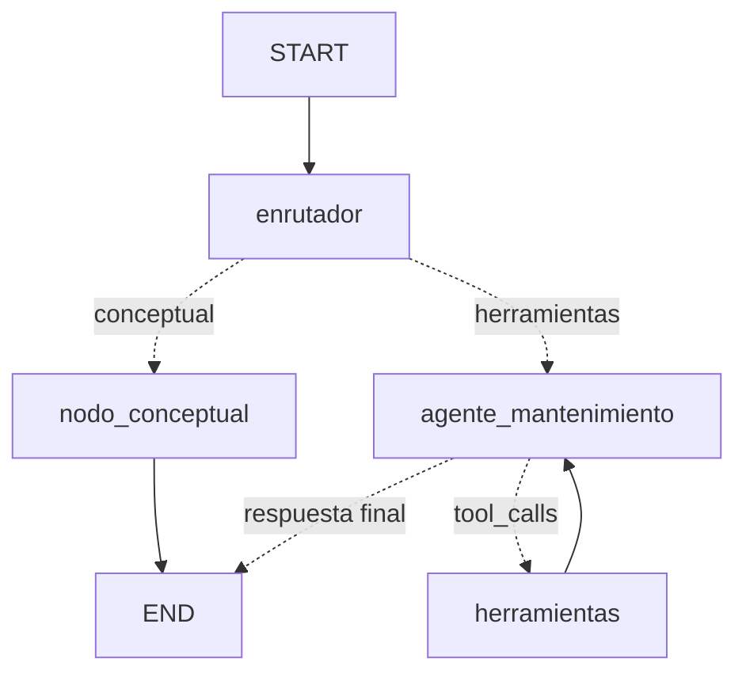

# MantenIA v3.1 — Asistente de mantenimiento de motocicletas

Sistema agéntico con **LangGraph** (grafo de estados cíclico, `ToolNode` y memoria con checkpointer) y **Gemini**, con interfaz Streamlit profesional, observabilidad y pruebas automatizadas.

> Curso: Sistemas Agénticos y Orquestadores de IA · Actividad P4 — Orquestación, despliegue y observabilidad.

- **App desplegada:** `https://<tu-app>.streamlit.app` _(completar tras el despliegue)_
- **Repositorio:** `https://github.com/<usuario>/<repo>` _(completar)_

## Problema que resuelve

Los propietarios de motos olvidan cuándo hicieron el último mantenimiento o qué revisiones necesita su moto según kilometraje y tiempo. MantenIA orienta con el historial, los intervalos técnicos, las alertas y los documentos (SOAT, tecnomecánica).

## Funcionalidades

Se conservan todas las de la v3: enrutador con salida estructurada, nodo conceptual, agente ReAct con **7 tools**, memoria por `thread_id`, estado de la moto detectado del texto y traza de nodos. La v3.1 añade:

| Área | Mejora |
|---|---|
| **Interfaz** | Tema oscuro propio, paleta neutra con iconos Material, navegación superior (Asistente · Garaje · Observabilidad), consultas de ejemplo, progreso en vivo por paso, indicadores de tipo de consulta/tools/tiempo/tokens bajo cada respuesta, exportar conversación, diseño responsivo |
| **Errores** | Mensajes claros por tipo (cuota, credenciales, red, modelo, ciclo), botón *Reintentar*, ayuda si falta la API key, la key nunca se muestra |
| **Observabilidad** | Latencia, tokens, llamadas al modelo, tools y errores por consulta; vista con gráficos; registro `logs/metricas.jsonl` |
| **Calidad** | 85 pruebas, 8 hallazgos corregidos ([`docs/PRUEBAS.md`](docs/PRUEBAS.md)), búsqueda de tools tolerante a tildes y varios términos |

## Arquitectura



Capas: `ui/` (presentación) → `core/` (sesión, métricas, errores, datos) → `graph/` (LangGraph) → `tools/` → `data/`. Estructura completa y reglas en [`docs/ARQUITECTURA.md`](docs/ARQUITECTURA.md).

### Herramientas (7)

| Tool | Función |
|---|---|
| `obtener_fecha` | Fecha, día y hora actuales |
| `consultar_moto` | Datos de una moto (marca, modelo, año, cilindraje, km) |
| `consultar_historial` | Mantenimientos realizados a una moto |
| `consultar_recomendaciones` | Intervalos técnicos por tipo de mantenimiento |
| `consultar_documentos_vehiculo` | SOAT, tecnomecánica y vencimientos |
| `consultar_alertas` | Alertas por estado, moto o palabra clave |
| `priorizar_alertas` | Chain determinista que prioriza las alertas pendientes |

## Instalación y ejecución

```bash
python -m venv venv
venv\Scripts\activate            # Windows  (Linux/macOS: source venv/bin/activate)
pip install -r requirements.txt
# el archivo .env ya incluye GEMINI_API_KEY y GEMINI_MODEL
streamlit run app.py
```

Variables: `GEMINI_API_KEY` (obligatoria), `GEMINI_MODEL` (por defecto `gemini-3.8-flash`).

## Pruebas y evaluación

```bash
pip install -r requirements-dev.txt
python -m pytest                       # 85 pruebas offline (modelo simulado)
python -m scripts.evaluar_agente       # 11 escenarios con Gemini real → docs/evidencias/
```

## Documentación y evidencias

| Documento | Contenido |
|---|---|
| [`docs/PRUEBAS.md`](docs/PRUEBAS.md) | Matriz de pruebas, hallazgos H1–H8 y correcciones |
| [`docs/OBSERVABILIDAD.md`](docs/OBSERVABILIDAD.md) | Métricas, dónde verlas y cómo comparar mejoras |
| [`docs/DESPLIEGUE.md`](docs/DESPLIEGUE.md) | Despliegue en Streamlit Cloud y guion de demostración |
| [`docs/evidencias/`](docs/evidencias/) | Diagnóstico inicial, salida de pytest, capturas, evaluación |

## Cumplimiento de la rúbrica

| Criterio | Dónde se evidencia |
|---|---|
| Mejoramiento de la interfaz | `ui/`, `.streamlit/config.toml`, capturas en `docs/evidencias/capturas/` |
| Pruebas funcionales e integración | `tests/`, `docs/PRUEBAS.md` |
| Observabilidad y métricas | `core/observability.py`, vista Observabilidad, `docs/OBSERVABILIDAD.md` |
| Identificación y corrección de hallazgos | Tabla H1–H8 y `evidencias/01_*` vs `02_*` |
| Repositorio | Este repositorio (código, `requirements.txt`, README, evidencias) |
| Despliegue y demostración | `docs/DESPLIEGUE.md` |

## Seguridad

`.env` y `venv/` están en `.gitignore`. No subas claves al repositorio; en la nube usa *Secrets*.
